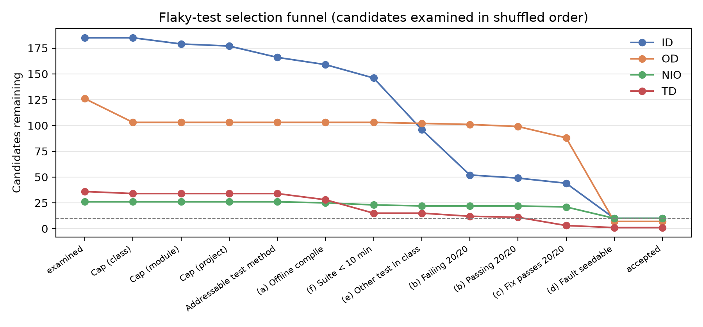
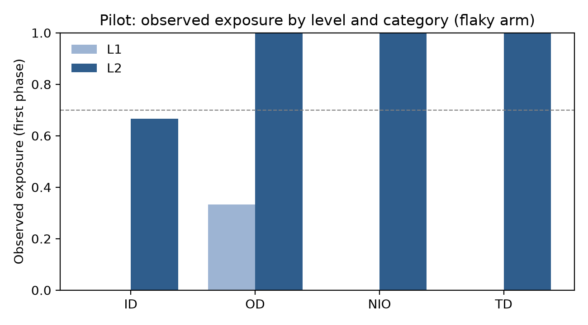

# Milestone 1: Infrastructure and Pilot

_Generated by `analysis/build_milestone1_report.py` from the logs in this directory. Do not edit by hand._

## 1. Summary

| Deliverable | Status |
|---|---|
| Selection procedure run for all four categories, with the selection log | partial |
| 40 tests selected; passing and failing configurations validated (20/20) | partial |
| Test shim with controlled failure rate, all four categories | done |
| Fault-seeding pipeline and 10 repair instances with control twins at L1 and L2 | done |
| Harness: headless agent in an offline container, full trajectory and final diff | done |
| Pilot with one agent: exposure at L1 and L2, main-study level, per-run cost | done |

## 2. Selection

Candidate pools in the ReproFlake index:

| category | index_count | expected | match |
|---|---|---|---|
| ID | 819 | 819 | True |
| OD | 126 | 126 | True |
| NIO | 125 | 125 | True |
| TD | 36 | 36 | True |
| unclassified (excluded) | 9 | 9 | True |

Seeds (`config/seeds.yaml`): `selection_shuffle=20261022`, `mutant_choice=382`, `pilot_order=1115`, `shim_base=7919`.

Categories are processed scarcest first (TD, NIO, OD, ID) because the diversity caps are global. Within a category, candidates are examined strictly in shuffled order.



| category | examined | Diversity cap (class) | Diversity cap (module) | Diversity cap (project) | Addressable test method | (a) Offline compile | (f) Suite < 10 min | (e) Other test in class | (b) Failing config 20/20 | (b) Passing config 20/20 | (c) Fix passes 20/20 | (d) Fault seedable | accepted |
|---|---|---|---|---|---|---|---|---|---|---|---|---|---|
| ID | 185 | 185 | 179 | 177 | 166 | 159 | 146 | 96 | 52 | 49 | 44 | 10 | 10 |
| OD | 126 | 103 | 103 | 103 | 103 | 103 | 103 | 102 | 101 | 99 | 88 | 7 | 7 |
| NIO | 26 | 26 | 26 | 26 | 26 | 25 | 23 | 22 | 22 | 22 | 21 | 10 | 10 |
| TD | 36 | 34 | 34 | 34 | 34 | 28 | 15 | 15 | 12 | 11 | 3 | 1 | 1 |

Rejections by first failing check:

| category | rejection_reason | count |
|---|---|---|
| ID | a_offline_compile | 7 |
| ID | addressable | 11 |
| ID | b_failing_20 | 44 |
| ID | b_passing_20 | 3 |
| ID | c_fixed_20 | 5 |
| ID | cap_module | 6 |
| ID | cap_project | 2 |
| ID | d_seedable | 34 |
| ID | e_other_deterministic | 50 |
| ID | f_suite_under_10min | 13 |
| NIO | a_offline_compile | 1 |
| NIO | c_fixed_20 | 1 |
| NIO | d_seedable | 11 |
| NIO | e_other_deterministic | 1 |
| NIO | f_suite_under_10min | 2 |
| OD | b_failing_20 | 1 |
| OD | b_passing_20 | 2 |
| OD | c_fixed_20 | 11 |
| OD | cap_class | 23 |
| OD | d_seedable | 81 |
| OD | e_other_deterministic | 1 |
| TD | a_offline_compile | 6 |
| TD | b_failing_20 | 3 |
| TD | b_passing_20 | 1 |
| TD | c_fixed_20 | 8 |
| TD | cap_class | 2 |
| TD | d_seedable | 2 |
| TD | f_suite_under_10min | 13 |

**Below 10:** OD 7/10 (pool exhausted: shortfall), TD 1/10 (pool exhausted: shortfall)

## 3. Selected tests

| category | project | module | test | java | target_class | mutant |
|---|---|---|---|---|---|---|
| TD | HADOOP-10394 | hadoop-common-project/hadoop-auth | org.apache.hadoop.security.authentication.server.TestAuthenticationFilter#testDoFilterAuthenticationWithInvalidToken | 8 | org.apache.hadoop.security.authentication.server.AuthenticationFilter | VOID_METHOD_CALLS doFilter L402 |
| NIO | quickcheckc1c | core | com.pholser.junit.quickcheck.ExhaustingAGivenSetButIncludingAnotherTest#wrapperShorts | 8 | com.pholser.junit.quickcheck.internal.ParameterTypeContext | INCREMENTS parameterIndex L165 |
| NIO | quickcheck485 | core | com.pholser.junit.quickcheck.ExhaustingAGivenSetButIncludingAnotherTest#enums | 8 | com.pholser.junit.quickcheck.internal.generator.GeneratorRepository | NULL_RETURNS generatorFor L249 |
| NIO | quickcheck485 | core | com.pholser.junit.quickcheck.PropertyParameterConfigurationIsolationTest#acrossParametersOfSameType | 8 | com.pholser.junit.quickcheck.internal.generator.GeneratorRepository | VOID_METHOD_CALLS applyComponentGenerators L406 |
| NIO | quickcheckc1c | core | com.pholser.junit.quickcheck.ExhaustingAGivenSetButIncludingAnotherTest#primitiveDoubles | 8 | com.pholser.junit.quickcheck.internal.ParameterTypeContext | PRIMITIVE_RETURNS parameterIndex L167 |
| NIO | quickcheck485 | core | com.pholser.junit.quickcheck.ExhaustingAGivenSetButIncludingAnotherTest#ctorOnly | 8 | com.pholser.junit.quickcheck.internal.ParameterTypeContext | PRIMITIVE_RETURNS parameterIndex L167 |
| NIO | quickcheckc1c | core | com.pholser.junit.quickcheck.SamplingButAlsoIncludingAGivenSetTest#wrapperShorts | 8 | com.pholser.junit.quickcheck.internal.ParameterTypeContext | INCREMENTS parameterIndex L165 |
| NIO | quickcheck485 | core | com.pholser.junit.quickcheck.ExhaustingAGivenSetButIncludingAnotherTest#primitiveBooleans | 8 | com.pholser.junit.quickcheck.internal.ParameterTypeContext | PRIMITIVE_RETURNS parameterIndex L167 |
| NIO | quickcheckce2 | core | com.pholser.junit.quickcheck.SamplingButAlsoIncludingAGivenSetTest#wrapperChars | 8 | com.pholser.junit.quickcheck.internal.ParameterTypeContext | INCREMENTS parameterIndex L165 |
| NIO | quickcheckc1c | core | com.pholser.junit.quickcheck.SamplingButAlsoIncludingAGivenSetTest#wrapperLongs | 8 | com.pholser.junit.quickcheck.internal.ParameterTypeContext | INCREMENTS parameterIndex L165 |
| NIO | quickcheckc1c | core | com.pholser.junit.quickcheck.ExhaustingAGivenSetButIncludingAnotherTest#wrapperLongs | 8 | com.pholser.junit.quickcheck.internal.ParameterTypeContext | PRIMITIVE_RETURNS parameterIndex L167 |
| OD | ormlitecore59309e5 | . | com.j256.ormlite.support.DatabaseConnectionProxyFactoryTest#testBasic | 8 | com.j256.ormlite.field.FieldType | VOID_METHOD_CALLS assignIdValue L613 |
| OD | ormlitecore59309e5 | . | com.j256.ormlite.misc.TransactionManagerTest#testSpringWiredRollBack | 8 | com.j256.ormlite.misc.TransactionManager | VOID_METHOD_CALLS callInTransaction L182 |
| OD | wildflynaming3a83b7b | naming | org.jboss.as.naming.ServiceBasedNamingStoreTestCase#testListBindings | 8 | org.jboss.as.naming.ServiceBasedNamingStore | NEGATE_CONDITIONALS lookup L86 |
| OD | ormlitecore59309e5 | . | com.j256.ormlite.table.SchemaUtilsTest#testCreateSchema | 8 | com.j256.ormlite.table.SchemaUtils | PRIMITIVE_RETURNS createSchema L79 |
| OD | ormlitecore59309e5 | . | com.j256.ormlite.support.BaseConnectionSourceTest#testClearNone | 8 | com.j256.ormlite.support.BaseConnectionSource | NEGATE_CONDITIONALS clearSpecial L87 |
| OD | ormlitecore59309e5 | . | com.j256.ormlite.stmt.StatementExecutorTest#testCallBatchTasksNestedInTransaction | 8 | com.j256.ormlite.stmt.StatementExecutor | NULL_RETURNS queryForId L93 |
| OD | shardingsphereelasticjobelasticjoblitecore90e3a7f | elastic-job-lite-core | io.elasticjob.lite.reg.zookeeper.ZookeeperRegistryCenterModifyTest#assertPersistEphemeralSequential | 8 | io.elasticjob.lite.reg.zookeeper.ZookeeperRegistryCenter | VOID_METHOD_CALLS update L232 |
| ID | commons-lang | . | org.apache.commons.lang3.builder.HashCodeBuilderTest#testReflectionHashCodeExcludeFields | 8 | org.apache.commons.lang3.builder.HashCodeBuilder | NEGATE_CONDITIONALS append L897 |
| ID | pulsar | pulsar-client | org.apache.pulsar.client.impl.schema.KeyValueSchemaInfoTest#testKeyValueSchemaInfoToString | 11 | org.apache.pulsar.client.impl.schema.KeyValueSchemaInfo | VOID_METHOD_CALLS encodeKeyValueSchemaInfo L164 |
| ID | nifi | nifi-commons/nifi-record | org.apache.nifi.serialization.record.TestMapRecord#testAliasConflictingAliasValues | 11 | org.apache.nifi.serialization.record.MapRecord | NULL_RETURNS getValue L163 |
| ID | typescript-generator | typescript-generator-core | cz.habarta.typescript.generator.EnumTest#testSingleEnum | 11 | cz.habarta.typescript.generator.Settings | NEGATE_CONDITIONALS validate L362 |
| ID | liquibase | liquibase-core | liquibase.sqlgenerator.core.DropColumnGeneratorTest#testDropMultipleColumnsMySQL | 8 | liquibase.sqlgenerator.core.DropColumnGenerator | NULL_RETURNS validate L35 |
| ID | byte-buddy | byte-buddy-dep | net.bytebuddy.implementation.auxiliary.MethodCallProxyTest#testNonGenericParameter | 8 | net.bytebuddy.TypeCache | NULL_RETURNS findOrInsert L187 |
| ID | json-schema | core | org.everit.json.schema.ObjectSchemaTest#toStringNoExplicitType | 11 | org.everit.json.schema.ObjectSchema | TRUE_RETURNS permitsAdditionalProperties L276 |
| ID | SCB-2731 | common/common-rest | org.apache.servicecomb.common.rest.filter.inner.RestServerCodecFilterTest#should_convert_exception_to_response_when_decode_request_failed | 11 | org.apache.servicecomb.common.rest.filter.inner.RestServerCodecFilter | VOID_METHOD_CALLS copyHeadersToHttpResponse L136 |
| ID | JSON-java | . | org.json.junit.JSONPointerTest#queryByEmptyKeySubObject | 8 | org.json.JSONPointer | VOID_METHOD_CALLS <init> L157 |
| ID | mybatis-3 | . | org.apache.ibatis.reflection.ReflectorTest#shouldSettersWithUnrelatedArgTypesThrowException | 8 | org.apache.ibatis.reflection.Reflector | VOID_METHOD_CALLS <init> L66 |

## 4. Configuration validation

Every selected test was run 20 times under each configuration in our containers (checks (b) and (c)); the seeded-fault version was rechecked 20/20 (seeding).

| category | test | failing config: failed | passing config: passed | Fixed.patch under failing: passed |
|---|---|---|---|---|
| TD | TestAuthenticationFilter#testDoFilterAuthenticationWithInvalidToken | 20/20 | 20/20 | 20/20 |
| NIO | ExhaustingAGivenSetButIncludingAnotherTest#wrapperShorts | 20/20 | 20/20 | 20/20 |
| NIO | ExhaustingAGivenSetButIncludingAnotherTest#enums | 20/20 | 20/20 | 20/20 |
| NIO | PropertyParameterConfigurationIsolationTest#acrossParametersOfSameType | 20/20 | 20/20 | 20/20 |
| NIO | ExhaustingAGivenSetButIncludingAnotherTest#primitiveDoubles | 20/20 | 20/20 | 20/20 |
| NIO | ExhaustingAGivenSetButIncludingAnotherTest#ctorOnly | 20/20 | 20/20 | 20/20 |
| NIO | SamplingButAlsoIncludingAGivenSetTest#wrapperShorts | 20/20 | 20/20 | 20/20 |
| NIO | ExhaustingAGivenSetButIncludingAnotherTest#primitiveBooleans | 20/20 | 20/20 | 20/20 |
| NIO | SamplingButAlsoIncludingAGivenSetTest#wrapperChars | 20/20 | 20/20 | 20/20 |
| NIO | SamplingButAlsoIncludingAGivenSetTest#wrapperLongs | 20/20 | 20/20 | 20/20 |
| NIO | ExhaustingAGivenSetButIncludingAnotherTest#wrapperLongs | 20/20 | 20/20 | 20/20 |
| OD | DatabaseConnectionProxyFactoryTest#testBasic | 20/20 | 20/20 | 20/20 |
| OD | TransactionManagerTest#testSpringWiredRollBack | 20/20 | 20/20 | 20/20 |
| OD | ServiceBasedNamingStoreTestCase#testListBindings | 20/20 | 20/20 | 20/20 |
| OD | SchemaUtilsTest#testCreateSchema | 20/20 | 20/20 | 20/20 |
| OD | BaseConnectionSourceTest#testClearNone | 20/20 | 20/20 | 20/20 |
| OD | StatementExecutorTest#testCallBatchTasksNestedInTransaction | 20/20 | 20/20 | 20/20 |
| OD | ZookeeperRegistryCenterModifyTest#assertPersistEphemeralSequential | 20/20 | 20/20 | 20/20 |
| ID | HashCodeBuilderTest#testReflectionHashCodeExcludeFields | 20/20 | 20/20 | 20/20 |
| ID | KeyValueSchemaInfoTest#testKeyValueSchemaInfoToString | 20/20 | 20/20 | 20/20 |
| ID | TestMapRecord#testAliasConflictingAliasValues | 20/20 | 20/20 | 20/20 |
| ID | EnumTest#testSingleEnum | 20/20 | 20/20 | 20/20 |
| ID | DropColumnGeneratorTest#testDropMultipleColumnsMySQL | 20/20 | 20/20 | 20/20 |
| ID | MethodCallProxyTest#testNonGenericParameter | 20/20 | 20/20 | 20/20 |
| ID | ObjectSchemaTest#toStringNoExplicitType | 20/20 | 20/20 | 20/20 |
| ID | RestServerCodecFilterTest#should_convert_exception_to_response_when_decode_request_failed | 20/20 | 20/20 | 20/20 |
| ID | JSONPointerTest#queryByEmptyKeySubObject | 20/20 | 20/20 | 20/20 |
| ID | ReflectorTest#shouldSettersWithUnrelatedArgTypesThrowException | 20/20 | 20/20 | 20/20 |

No failures.

## 5. Shim design and tests

How a flaky failure reaches the agent: `fb-ext` (a Maven core extension in the agent's `lib/ext`) attaches itself as a Java agent to every Surefire fork. The agent replaces the flaky test's body with a call to the oracle sidecar, which draws the configuration (once per Maven invocation), reproduces it on a private copy of the agent's current tree, and relays the outcome: a pass, or the exact Surefire-reported failure (exception type, message, frames, causes).

| Category | Failing configuration (reproduced by the oracle) |
|---|---|
| ID | NonDex 2.1.1 with ReproFlake's stored seed, victim only |
| OD | ReproFlake's custom Surefire (`runOrder=testorder`): polluter, then victim, same JVM |
| NIO | Victim run twice in one JVM (fb-ext repeat mode); second run reported |
| TD | ReproFlake's delay patch applied to the oracle's copy only; frame line numbers mapped back |

Draw rules: no edit yet → passing; first invocation after the first edit → failing; afterwards failing with probability p = 0.5 from a per-run seeded RNG. Every draw is logged.

Unit tests (draw rules, trace parsing):

| test | result |
|---|---|
| test_oracle::test_pre_edit_always_passes | pass |
| test_oracle::test_build_outputs_are_not_edits | pass |
| test_oracle::test_first_post_edit_always_fails | pass |
| test_oracle::test_one_draw_per_invocation | pass |
| test_oracle::test_p_zero_and_one | pass |
| test_oracle::test_same_seed_same_draws | pass |
| test_oracle::test_rate_close_to_p | pass |
| test_oracle::test_forced_modes[force_failing-failing] | pass |
| test_oracle::test_forced_modes[force_passing-passing] | pass |
| test_surefire::test_chain_and_frames | pass |
| test_surefire::test_no_message_and_fallback | pass |

End-to-end through the real path, per category:

| category | arm | step | expected | observed | ok |
|---|---|---|---|---|---|
| TD | flaky | pre-edit run | pass | pass | True |
| TD | flaky | first run after first edit | fail | fail | True |
| TD | flaky | forced passing configuration | pass | pass | True |
| TD | flaky | forced failing configuration | fail | fail | True |
| TD | control | pre-edit run | pass | pass | True |
| TD | control | first run after first edit | pass | pass | True |
| TD | control | forced passing configuration | pass | pass | True |
| TD | control | forced failing configuration | pass | pass | True |
| ID | flaky | pre-edit run | pass | pass | True |
| ID | flaky | first run after first edit | fail | fail | True |
| ID | flaky | forced passing configuration | pass | pass | True |
| ID | flaky | forced failing configuration | fail | fail | True |
| OD | flaky | pre-edit run | pass | pass | True |
| OD | flaky | first run after first edit | fail | fail | True |
| OD | flaky | forced passing configuration | pass | pass | True |
| OD | flaky | forced failing configuration | fail | fail | True |
| NIO | flaky | pre-edit run | pass | pass | True |
| NIO | flaky | first run after first edit | fail | fail | True |
| NIO | flaky | forced passing configuration | pass | pass | True |
| NIO | flaky | forced failing configuration | fail | fail | True |

## 6. Fault seeding

Mutants are examined in seeded random order until the first one passes every filter, so 'examined' counts stop at the chosen mutant.

| category | test | target class | candidate methods | mutants generated | examined | compiled | killed by >=2 | killers in L1+L2 classes | killers fail alone | flaky test unchanged | 20/20 recheck | chosen |
|---|---|---|---|---|---|---|---|---|---|---|---|---|
| TD | TestAuthenticationFilter#testDoFilterAuthenticationWithInvalidToken | AuthenticationFilter | 10 | 57 | 4 | 4 | 4 | 3 | 3 | 1 | 1 | VOID_METHOD_CALLS L402 |
| TD | EmptyPropertiesTest#testSave | PropertiesFactory | 1 | 1 | 1 | 1 | 1 | 0 | 0 | 0 | 0 | none: no mutant survives the filters |
| TD | TestTimelineClientV2Impl#testSyncCall | TimelineV2ClientImpl | 6 | 9 | 9 | 9 | 5 | 0 | 0 | 0 | 0 | none: no mutant survives the filters |
| NIO | ExhaustingAGivenSetButIncludingAnotherTest#wrapperShorts | ParameterTypeContext | 15 | 38 | 9 | 9 | 8 | 5 | 5 | 1 | 1 | INCREMENTS L165 |
| NIO | ExhaustingAGivenSetTest#booleansUnmarked | PropertyStatement | 8 | 9 | 9 | 9 | 5 | 4 | 4 | 0 | 0 | none: no mutant survives the filters |
| NIO | ExhaustingAGivenSetTest#enumsUnmarked | PropertyStatement | 8 | 9 | 9 | 9 | 5 | 4 | 4 | 0 | 0 | none: no mutant survives the filters |
| NIO | EnumPropertyParameterTypesTest#whenConstrained | GeneratorRepository | 11 | 25 | 25 | 25 | 20 | 3 | 3 | 0 | 0 | none: no mutant survives the filters |
| NIO | ExhaustingAGivenSetButIncludingAnotherTest#enums | GeneratorRepository | 11 | 25 | 23 | 23 | 18 | 3 | 3 | 1 | 1 | NULL_RETURNS L249 |
| NIO | ExhaustingAGivenSetTest#wrapperBytes | PropertyStatement | 8 | 9 | 9 | 9 | 5 | 4 | 4 | 0 | 0 | none: no mutant survives the filters |
| NIO | ExhaustingAGivenSetButIncludingAnotherTest#manyParameters | ParameterTypeContext | 15 | 38 | 38 | 38 | 28 | 18 | 18 | 0 | 0 | none: no mutant survives the filters |
| NIO | PropertyParameterConfigurationIsolationTest#acrossParametersOfSameType | GeneratorRepository | 19 | 53 | 22 | 22 | 20 | 12 | 12 | 1 | 1 | VOID_METHOD_CALLS L406 |
| NIO | ExhaustingAGivenSetButIncludingAnotherTest#primitiveDoubles | ParameterTypeContext | 15 | 38 | 27 | 27 | 21 | 12 | 12 | 1 | 1 | PRIMITIVE_RETURNS L167 |
| NIO | ExhaustingAGivenSetTest#primitiveFloats | PropertyStatement | 8 | 9 | 9 | 9 | 5 | 4 | 4 | 0 | 0 | none: no mutant survives the filters |
| NIO | SamplingOnlyFromAGivenSetTest#manyParameters | PropertyStatement | 8 | 9 | 9 | 9 | 5 | 4 | 4 | 0 | 0 | none: no mutant survives the filters |
| NIO | ExhaustingAGivenSetButIncludingAnotherTest#ctorOnly | ParameterTypeContext | 15 | 38 | 28 | 28 | 21 | 14 | 14 | 1 | 1 | PRIMITIVE_RETURNS L167 |
| NIO | SamplingButAlsoIncludingAGivenSetTest#wrapperShorts | ParameterTypeContext | 15 | 38 | 15 | 15 | 11 | 7 | 7 | 1 | 1 | INCREMENTS L165 |
| NIO | ExhaustingAGivenSetButIncludingAnotherTest#primitiveBooleans | ParameterTypeContext | 15 | 38 | 10 | 10 | 7 | 5 | 5 | 1 | 1 | PRIMITIVE_RETURNS L167 |
| NIO | ExhaustingAGivenSetTest#manyParameters | PropertyStatement | 8 | 9 | 9 | 9 | 5 | 4 | 4 | 0 | 0 | none: no mutant survives the filters |
| NIO | SamplingButAlsoIncludingAGivenSetTest#wrapperChars | ParameterTypeContext | 15 | 38 | 14 | 14 | 13 | 8 | 8 | 1 | 1 | INCREMENTS L165 |
| NIO | SamplingOnlyFromAGivenSetTest#enums | PropertyStatement | 8 | 9 | 9 | 9 | 5 | 4 | 4 | 0 | 0 | none: no mutant survives the filters |
| NIO | ExhaustingAGivenSetTest#primitiveBytes | PropertyStatement | 8 | 9 | 9 | 9 | 5 | 4 | 4 | 0 | 0 | none: no mutant survives the filters |
| NIO | ExhaustingAGivenSetTest#favorValueOf | PropertyStatement | 8 | 9 | 9 | 9 | 5 | 4 | 4 | 0 | 0 | none: no mutant survives the filters |
| NIO | SamplingButAlsoIncludingAGivenSetTest#wrapperLongs | ParameterTypeContext | 15 | 38 | 26 | 26 | 17 | 11 | 11 | 1 | 1 | INCREMENTS L165 |
| NIO | ExhaustingAGivenSetButIncludingAnotherTest#wrapperLongs | ParameterTypeContext | 15 | 38 | 11 | 11 | 8 | 7 | 7 | 1 | 1 | PRIMITIVE_RETURNS L167 |
| OD | DirectoryManagerFactoryTest#createDirectoryManagerIoException | DirectoryManagerFactory | 1 | 2 | 2 | 1 | 1 | 0 | 0 | 0 | 0 | none: no mutant survives the filters |
| OD | DatabaseConnectionProxyFactoryTest#testBasic | FieldType | 33 | 124 | 59 | 59 | 48 | 25 | 24 | 1 | 1 | VOID_METHOD_CALLS L613 |
| OD | FailoverServiceTest#assertGetLocalFailoverItemsIfShutdown | FailoverService | 1 | 0 | 0 | 0 | 0 | 0 | 0 | 0 | 0 | none: no mutant survives the filters |
| OD | RuntimeExceptionDaoTest#testQueryForMatchingArgsThrow | RuntimeExceptionDao | 2 | 1 | 1 | 1 | 0 | 0 | 0 | 0 | 0 | none: no mutant survives the filters |
| OD | RuntimeExceptionDaoTest#testCountOfThrow | RuntimeExceptionDao | 3 | 5 | 5 | 3 | 0 | 0 | 0 | 0 | 0 | none: no mutant survives the filters |
| OD | NamingEventCoordinatorTestCase#testFireObjectEvent | NamingEventCoordinator | 3 | 21 | 21 | 21 | 16 | 0 | 0 | 0 | 0 | none: no mutant survives the filters |
| OD | RuntimeExceptionDaoTest#testIdExistsThrows | RuntimeExceptionDao | 2 | 1 | 1 | 1 | 0 | 0 | 0 | 0 | 0 | none: no mutant survives the filters |
| OD | RuntimeExceptionDaoTest#testRollbackThrows | RuntimeExceptionDao | 2 | 1 | 1 | 1 | 0 | 0 | 0 | 0 | 0 | none: no mutant survives the filters |
| OD | TransactionManagerTest#testSpringWiredRollBack | TransactionManager | 5 | 40 | 5 | 5 | 3 | 1 | 1 | 1 | 1 | VOID_METHOD_CALLS L182 |
| OD | RuntimeExceptionDaoTest#testQueryForEqThrow | RuntimeExceptionDao | 2 | 1 | 1 | 1 | 0 | 0 | 0 | 0 | 0 | none: no mutant survives the filters |
| OD | RuntimeExceptionDaoTest#testSetAutoCommitThrows | RuntimeExceptionDao | 2 | 1 | 1 | 1 | 0 | 0 | 0 | 0 | 0 | none: no mutant survives the filters |
| OD | RuntimeExceptionDaoTest#testQueryForFirstPreparedThrow | RuntimeExceptionDao | 2 | 1 | 1 | 1 | 0 | 0 | 0 | 0 | 0 | none: no mutant survives the filters |
| OD | RuntimeExceptionDaoTest#testQueryForSameIdThrow | RuntimeExceptionDao | 2 | 1 | 1 | 1 | 0 | 0 | 0 | 0 | 0 | none: no mutant survives the filters |
| OD | SchemaUtilsTest#testCreateSchemaName | SchemaUtils | 8 | 46 | 46 | 46 | 21 | 11 | 11 | 0 | 0 | none: no mutant survives the filters |
| OD | RuntimeExceptionDaoTest#testGetEmptyForeignCollectionThrow | RuntimeExceptionDao | 2 | 1 | 1 | 1 | 0 | 0 | 0 | 0 | 0 | none: no mutant survives the filters |
| OD | RuntimeExceptionDaoTest#testCreateCollectionThrow | RuntimeExceptionDao | 3 | 5 | 5 | 3 | 0 | 0 | 0 | 0 | 0 | none: no mutant survives the filters |
| OD | JobRegistryTest#assertGetCurrentShardingTotalCountIfNull | JobRegistry | 2 | 6 | 6 | 6 | 5 | 5 | 5 | 0 | 0 | none: no mutant survives the filters |
| OD | RuntimeExceptionDaoTest#testCountOfPreparedThrow | RuntimeExceptionDao | 3 | 5 | 5 | 3 | 0 | 0 | 0 | 0 | 0 | none: no mutant survives the filters |
| OD | RuntimeExceptionDaoTest#testCommitThrows | RuntimeExceptionDao | 2 | 1 | 1 | 1 | 0 | 0 | 0 | 0 | 0 | none: no mutant survives the filters |
| OD | RuntimeExceptionDaoTest#testQueryThrow | RuntimeExceptionDao | 2 | 1 | 1 | 1 | 0 | 0 | 0 | 0 | 0 | none: no mutant survives the filters |
| OD | RuntimeExceptionDaoTest#testQueryForFieldsValuesArgsThrow | RuntimeExceptionDao | 2 | 1 | 1 | 1 | 0 | 0 | 0 | 0 | 0 | none: no mutant survives the filters |
| OD | WritableServiceBasedNamingStoreTestCase#testBind | WritableServiceBasedNamingStore | 5 | 16 | 16 | 16 | 9 | 0 | 0 | 0 | 0 | none: no mutant survives the filters |
| OD | BaseDatabaseTypeTest#testDriverNotFound | BaseDatabaseType | 3 | 5 | 5 | 4 | 0 | 0 | 0 | 0 | 0 | none: no mutant survives the filters |
| OD | RuntimeExceptionDaoTest#testIsTableExistsThrow | RuntimeExceptionDao | 2 | 1 | 1 | 1 | 0 | 0 | 0 | 0 | 0 | none: no mutant survives the filters |
| OD | NamingEventCoordinatorTestCase#testFireMultiLevelEvent | NamingEventCoordinator | 3 | 21 | 21 | 21 | 17 | 0 | 0 | 0 | 0 | none: no mutant survives the filters |
| OD | RuntimeExceptionDaoTest#testDeleteThrow | RuntimeExceptionDao | 3 | 7 | 7 | 4 | 0 | 0 | 0 | 0 | 0 | none: no mutant survives the filters |
| OD | RuntimeExceptionDaoTest#testEndThreadConnectionThrows | RuntimeExceptionDao | 2 | 1 | 1 | 1 | 0 | 0 | 0 | 0 | 0 | none: no mutant survives the filters |
| OD | RuntimeExceptionDaoTest#testCreateOrUpdateThrow | RuntimeExceptionDao | 2 | 1 | 1 | 1 | 0 | 0 | 0 | 0 | 0 | none: no mutant survives the filters |
| OD | RuntimeExceptionDaoTest#testQueryRawDateTypesThrow | RuntimeExceptionDao | 3 | 31 | 31 | 16 | 0 | 0 | 0 | 0 | 0 | none: no mutant survives the filters |
| OD | NamingSubsystemTestCase#testSubsystem | NamingSubsystem14Parser | 9 | 71 | 71 | 71 | 52 | 0 | 0 | 0 | 0 | none: no mutant survives the filters |
| OD | RuntimeExceptionDaoTest#testDeleteIdsThrow | RuntimeExceptionDao | 2 | 1 | 1 | 1 | 0 | 0 | 0 | 0 | 0 | none: no mutant survives the filters |
| OD | ShellSetInstanceTest#testSetInstance_HdfsZooInstance_InstanceGiven |  | 0 | 0 | 0 | 0 | 0 | 0 | 0 | 0 | 0 | none: flaky test covers no production class |
| OD | PortTelnetHandlerTest#testListDetail | PortTelnetHandler | 1 | 25 | 25 | 25 | 7 | 0 | 0 | 0 | 0 | none: no mutant survives the filters |
| OD | RuntimeExceptionDaoTest#testIteratorThrow | RuntimeExceptionDao | 3 | 7 | 7 | 5 | 0 | 0 | 0 | 0 | 0 | none: no mutant survives the filters |
| OD | JdkProxyFactoryTest#testGetInvoker | JdkProxyFactory | 0 | 0 | 0 | 0 | 0 | 0 | 0 | 0 | 0 | none: no target method covered by the flaky test and >= 2 deterministic tests |
| OD | ChangeTelnetHandlerTest#testChangeServiceNotExport | ChangeTelnetHandler | 1 | 12 | 12 | 12 | 6 | 0 | 0 | 0 | 0 | none: no mutant survives the filters |
| OD | RuntimeExceptionDaoTest#testQueryRawValueThrow | RuntimeExceptionDao | 2 | 1 | 1 | 1 | 0 | 0 | 0 | 0 | 0 | none: no mutant survives the filters |
| OD | ServiceBasedNamingStoreTestCase#testListBindings | ServiceBasedNamingStore | 4 | 17 | 4 | 4 | 3 | 3 | 3 | 1 | 1 | NEGATE_CONDITIONALS L86 |
| OD | RuntimeExceptionDaoTest#testUpdateThrow | RuntimeExceptionDao | 3 | 5 | 5 | 3 | 0 | 0 | 0 | 0 | 0 | none: no mutant survives the filters |
| OD | NamingEventCoordinatorTestCase#testFireSubTreeEvent | NamingEventCoordinator | 3 | 21 | 21 | 21 | 17 | 0 | 0 | 0 | 0 | none: no mutant survives the filters |
| OD | ShellSetInstanceTest#testSetInstance_HdfsZooInstance_Explicit |  | 0 | 0 | 0 | 0 | 0 | 0 | 0 | 0 | 0 | none: flaky test covers no production class |
| OD | RuntimeExceptionDaoTest#testRefreshThrow | RuntimeExceptionDao | 2 | 1 | 1 | 1 | 0 | 0 | 0 | 0 | 0 | none: no mutant survives the filters |
| OD | RuntimeExceptionDaoTest#testCreateThrow | RuntimeExceptionDao | 3 | 5 | 5 | 3 | 0 | 0 | 0 | 0 | 0 | none: no mutant survives the filters |
| OD | SchemaUtilsTest#testCreateIfNotExists | SchemaUtils | 7 | 43 | 43 | 43 | 20 | 11 | 11 | 0 | 0 | none: no mutant survives the filters |
| OD | DirectoryManagerFactoryTest#createDefaultDirectoryManagerPath | DirectoryManagerFactory | 1 | 2 | 2 | 1 | 1 | 0 | 0 | 0 | 0 | none: no mutant survives the filters |
| OD | SchemaUtilsTest#testCreateSchema | SchemaUtils | 8 | 46 | 24 | 24 | 10 | 4 | 4 | 1 | 1 | PRIMITIVE_RETURNS L79 |
| OD | RuntimeExceptionDaoTest#testCallBatchTasksThrow | RuntimeExceptionDao | 2 | 1 | 1 | 1 | 0 | 0 | 0 | 0 | 0 | none: no mutant survives the filters |
| OD | QueryBuilderWithSchemaTest#testQueryRawColumnsNotQuery | TableUtils | 10 | 117 | 117 | 117 | 61 | 0 | 0 | 0 | 0 | none: no mutant survives the filters |
| OD | SchemaUtilsTest#testDropSchemaThrow | SchemaUtils | 4 | 25 | 17 | 17 | 4 | 2 | 2 | 1 | 1 | NEGATE_CONDITIONALS L219 |
| OD | RuntimeExceptionDaoTest#testDeleteCollectionThrow | RuntimeExceptionDao | 3 | 7 | 7 | 4 | 0 | 0 | 0 | 0 | 0 | none: no mutant survives the filters |
| OD | AbstractAISMessageListenerTest#testSequenceListenerWithIncorrectOrder | AbstractAISMessageListener | 2 | 3 | 3 | 3 | 2 | 0 | 0 | 0 | 0 | none: no mutant survives the filters |
| OD | BaseConnectionSourceTest#testClearNone | BaseConnectionSource | 2 | 10 | 4 | 4 | 2 | 1 | 1 | 1 | 1 | NEGATE_CONDITIONALS L87 |
| OD | StatementExecutorTest#testCallBatchTasksNestedInTransaction | StatementExecutor | 6 | 29 | 12 | 12 | 4 | 2 | 2 | 1 | 1 | NULL_RETURNS L93 |
| OD | RuntimeExceptionDaoTest#testSetObjectCacheCacheThrow | RuntimeExceptionDao | 3 | 5 | 5 | 3 | 0 | 0 | 0 | 0 | 0 | none: no mutant survives the filters |
| OD | RuntimeExceptionDaoTest#testQueryRawDatatypesThrows | RuntimeExceptionDao | 3 | 31 | 31 | 16 | 0 | 0 | 0 | 0 | 0 | none: no mutant survives the filters |
| OD | AISMessageFactoryTest#testCreateWithTwo | AISMessageFactory | 2 | 3 | 3 | 3 | 3 | 3 | 3 | 0 | 0 | none: no mutant survives the filters |
| OD | ShellSetInstanceTest#testSetInstance_HdfsZooInstance_Implicit |  | 0 | 0 | 0 | 0 | 0 | 0 | 0 | 0 | 0 | none: flaky test covers no production class |
| OD | RuntimeExceptionDaoTest#testQueryForAllThrow | RuntimeExceptionDao | 3 | 3 | 3 | 2 | 0 | 0 | 0 | 0 | 0 | none: no mutant survives the filters |
| OD | RuntimeExceptionDaoTest#testIsAutoCommitThrows | RuntimeExceptionDao | 2 | 1 | 1 | 1 | 0 | 0 | 0 | 0 | 0 | none: no mutant survives the filters |
| OD | RuntimeExceptionDaoTest#testExecuteRawNoArgsThrow | RuntimeExceptionDao | 3 | 7 | 7 | 4 | 0 | 0 | 0 | 0 | 0 | none: no mutant survives the filters |
| OD | RuntimeExceptionDaoTest#testExtractIdThrow | RuntimeExceptionDao | 2 | 1 | 1 | 1 | 0 | 0 | 0 | 0 | 0 | none: no mutant survives the filters |
| OD | ShellSetInstanceTest#testSetInstance_HdfsZooInstance_HostsGiven |  | 0 | 0 | 0 | 0 | 0 | 0 | 0 | 0 | 0 | none: flaky test covers no production class |
| OD | RuntimeExceptionDaoTest#testUpdateRawThrow | RuntimeExceptionDao | 2 | 1 | 1 | 1 | 0 | 0 | 0 | 0 | 0 | none: no mutant survives the filters |
| OD | RuntimeExceptionDaoTest#testGetSelectStarRowMapperThrow | RuntimeExceptionDao | 2 | 1 | 1 | 1 | 0 | 0 | 0 | 0 | 0 | none: no mutant survives the filters |
| OD | PortTelnetHandlerTest#testListAllPort | PortTelnetHandler | 1 | 25 | 25 | 25 | 7 | 0 | 0 | 0 | 0 | none: no mutant survives the filters |
| OD | RuntimeExceptionDaoTest#testCloseLastIteratorThrow | RuntimeExceptionDao | 3 | 3 | 3 | 3 | 1 | 0 | 0 | 0 | 0 | none: no mutant survives the filters |
| OD | RuntimeExceptionDaoTest#testDeletePreparedThrow | RuntimeExceptionDao | 3 | 7 | 7 | 4 | 0 | 0 | 0 | 0 | 0 | none: no mutant survives the filters |
| OD | ShutdownListenerManagerTest#assertIsShutdownAlready | ShutdownListenerManager | 1 | 0 | 0 | 0 | 0 | 0 | 0 | 0 | 0 | none: no mutant survives the filters |
| OD | RuntimeExceptionDaoTest#testQueryRawThrow | RuntimeExceptionDao | 3 | 31 | 31 | 16 | 0 | 0 | 0 | 0 | 0 | none: no mutant survives the filters |
| OD | RuntimeExceptionDaoTest#testMapSelectStarRowThrow | RuntimeExceptionDao | 2 | 1 | 1 | 1 | 0 | 0 | 0 | 0 | 0 | none: no mutant survives the filters |
| OD | RuntimeExceptionDaoTest#testQueryRawRowMapperThrow | RuntimeExceptionDao | 3 | 31 | 31 | 16 | 0 | 0 | 0 | 0 | 0 | none: no mutant survives the filters |
| OD | GroupTest#getgroups |  | 0 | 0 | 0 | 0 | 0 | 0 | 0 | 0 | 0 | none: flaky test covers no production class |
| OD | RuntimeExceptionDaoTest#testCreateIfNotExistsThrow | RuntimeExceptionDao | 2 | 1 | 1 | 1 | 0 | 0 | 0 | 0 | 0 | none: no mutant survives the filters |
| OD | RuntimeExceptionDaoTest#testObjectsEqualThrow | RuntimeExceptionDao | 2 | 1 | 1 | 1 | 0 | 0 | 0 | 0 | 0 | none: no mutant survives the filters |
| OD | RuntimeExceptionDaoTest#testSetObjectCacheThrow | RuntimeExceptionDao | 3 | 5 | 5 | 3 | 0 | 0 | 0 | 0 | 0 | none: no mutant survives the filters |
| OD | RuntimeExceptionDaoTest#testQueryForIdThrow | RuntimeExceptionDao | 3 | 3 | 3 | 2 | 0 | 0 | 0 | 0 | 0 | none: no mutant survives the filters |
| OD | RuntimeExceptionDaoTest#testIteratorQueryFlags | RuntimeExceptionDao | 3 | 7 | 7 | 5 | 0 | 0 | 0 | 0 | 0 | none: no mutant survives the filters |
| OD | RuntimeExceptionDaoTest#testCreateObjectInstanceThrows | RuntimeExceptionDao | 2 | 1 | 1 | 1 | 0 | 0 | 0 | 0 | 0 | none: no mutant survives the filters |
| OD | RuntimeExceptionDaoTest#testQueryRawMapperThrows | RuntimeExceptionDao | 3 | 31 | 31 | 16 | 0 | 0 | 0 | 0 | 0 | none: no mutant survives the filters |
| OD | RuntimeExceptionDaoTest#testAssignEmptyForeignCollectionThrow | RuntimeExceptionDao | 2 | 1 | 1 | 1 | 0 | 0 | 0 | 0 | 0 | none: no mutant survives the filters |
| OD | RuntimeExceptionDaoTest#testCloseLastIteratorThrows | RuntimeExceptionDao | 3 | 3 | 3 | 3 | 1 | 0 | 0 | 0 | 0 | none: no mutant survives the filters |
| OD | JavassistProxyFactoryTest#testGetInvoker | JavassistProxyFactory | 0 | 0 | 0 | 0 | 0 | 0 | 0 | 0 | 0 | none: no target method covered by the flaky test and >= 2 deterministic tests |
| OD | RuntimeExceptionDaoTest#testStartThreadConnectionThrows | RuntimeExceptionDao | 2 | 1 | 1 | 1 | 0 | 0 | 0 | 0 | 0 | none: no mutant survives the filters |
| OD | RuntimeExceptionDaoTest#testQueryForMatchingThrow | RuntimeExceptionDao | 2 | 1 | 1 | 1 | 0 | 0 | 0 | 0 | 0 | none: no mutant survives the filters |
| OD | RuntimeExceptionDaoTest#testUpdatePreparedThrow | RuntimeExceptionDao | 3 | 5 | 5 | 3 | 0 | 0 | 0 | 0 | 0 | none: no mutant survives the filters |
| OD | RuntimeExceptionDaoTest#testExecuteRawThrow | RuntimeExceptionDao | 3 | 7 | 7 | 4 | 0 | 0 | 0 | 0 | 0 | none: no mutant survives the filters |
| OD | RuntimeExceptionDaoTest#testQueryForFieldsValuesThrow | RuntimeExceptionDao | 2 | 1 | 1 | 1 | 0 | 0 | 0 | 0 | 0 | none: no mutant survives the filters |
| OD | RuntimeExceptionDaoTest#testUpdateIdThrow | RuntimeExceptionDao | 2 | 1 | 1 | 1 | 0 | 0 | 0 | 0 | 0 | none: no mutant survives the filters |
| OD | ZookeeperRegistryCenterModifyTest#assertPersistEphemeralSequential | ZookeeperRegistryCenter | 7 | 29 | 13 | 12 | 1 | 1 | 1 | 1 | 1 | VOID_METHOD_CALLS L232 |
| ID | HashCodeBuilderTest#testReflectionHashCodeExcludeFields | HashCodeBuilder | 9 | 114 | 6 | 6 | 5 | 2 | 2 | 1 | 1 | NEGATE_CONDITIONALS L897 |
| ID | QueryTest#testToQueryUrl | Query | 0 | 0 | 0 | 0 | 0 | 0 |  | 0 | 0 | none: no target method covered by the flaky test and >= 2 deterministic tests |
| ID | KeyValueSchemaInfoTest#testKeyValueSchemaInfoToString | KeyValueSchemaInfo | 5 | 16 | 2 | 2 | 2 | 2 | 2 | 1 | 1 | VOID_METHOD_CALLS L164 |
| ID | EnumConstantsExtensionTest#basicTest | EnumConstantsExtension | 2 | 6 | 6 | 5 | 0 | 0 |  | 0 | 0 | none: no mutant survives the filters |
| ID | ImportHooksTest#updateUserProfile | Hooks | 1 | 1 | 1 | 1 | 1 | 1 |  | 0 | 0 | none: no mutant survives the filters |
| ID | RequestHeadersTest#shouldPrintHeaders | RequestHeaders | 3 | 13 | 13 | 13 | 3 | 1 |  | 0 | 0 | none: no mutant survives the filters |
| ID | CastleUserDeviceContextTest#fullBuilderJson | CastleUserDeviceContext | 7 | 5 | 5 | 5 | 0 | 0 |  | 0 | 0 | none: no mutant survives the filters |
| ID | ImportHooksTest#linkUserTest | Hooks | 1 | 1 | 1 | 1 | 1 | 1 |  | 0 | 0 | none: no mutant survives the filters |
| ID | WebClientImplTest#whenUnprotected_sendPutToServer | WebClientImpl | 4 | 4 | 4 | 4 | 3 | 0 |  | 0 | 0 | none: no mutant survives the filters |
| ID | TestMapRecord#testAliasConflictingAliasValues | MapRecord | 3 | 16 | 1 | 1 | 1 | 1 | 1 | 1 | 1 | NULL_RETURNS L163 |
| ID | TestFetchHBaseRow#testFetchToContentWithStringValues | FetchHBaseRow | 6 | 26 | 26 | 26 | 12 | 0 |  | 0 | 0 | none: no mutant survives the filters |
| ID | IndexLabelTest#testIndexLabel | IndexLabel | 2 | 2 | 2 | 2 | 2 | 0 |  | 0 | 0 | none: no mutant survives the filters |
| ID | ExplicitPropertyParameterGeneratorsChosenWithEqualProbabilityTest#producesExpectedRandomValues | GeneratorRepository | 13 | 39 | 39 | 39 | 32 | 0 |  | 0 | 0 | none: no mutant survives the filters |
| ID | EnumTest#testSingleEnum | Settings | 18 | 127 | 1 | 1 | 1 | 1 | 1 | 1 | 1 | NEGATE_CONDITIONALS L362 |
| ID | TokenHooksTest#tokenExpiration | Hooks | 1 | 1 | 1 | 1 | 1 | 1 |  | 0 | 0 | none: no mutant survives the filters |
| ID | DropColumnGeneratorTest#testDropMultipleColumnsMySQL | DropColumnGenerator | 3 | 10 | 6 | 6 | 1 | 1 | 1 | 1 | 1 | NULL_RETURNS L35 |
| ID | SetOfSuperFloatPropertyParameterTest#verifyInteractionWithRandomness |  | 0 | 0 | 0 | 0 | 0 | 0 |  | 0 | 0 | none: flaky test covers no production class |
| ID | PluginManagerTest#testGetPluginsToLoad | PluginManager | 1 | 1 | 1 | 0 | 0 | 0 |  | 0 | 0 | none: no mutant survives the filters |
| ID | TestFetchHBaseRow#testFetchToAttributesWithStringValues | FetchHBaseRow | 6 | 26 | 26 | 26 | 12 | 0 |  | 0 | 0 | none: no mutant survives the filters |
| ID | DefaultSegmentedClientTest#verifyThatSegmentsAreRetrievedOnlyOnce | DefaultSegmentedClient | 3 | 6 | 6 | 2 | 1 | 1 |  | 0 | 0 | none: no mutant survives the filters |
| ID | MethodCallProxyTest#testNonGenericParameter | TypeCache | 3 | 14 | 3 | 3 | 1 | 1 | 1 | 1 | 1 | NULL_RETURNS L187 |
| ID | InheritingMetadataContainerTest#testRemove1 | InheritingMetadataContainer | 15 | 48 | 48 | 48 | 25 | 0 |  | 0 | 0 | none: no mutant survives the filters |
| ID | PredicatedSetTest#testCollectionToArray2 | PredicatedSet | 4 | 3 | 3 | 3 | 3 | 3 |  | 0 | 0 | none: no mutant survives the filters |
| ID | Issue3082#test_for_issue |  | 0 | 0 | 0 | 0 | 0 | 0 |  | 0 | 0 | none: flaky test covers no production class |
| ID | InheritingMetadataContainerTest#testPut2 | InheritingMetadataContainer | 5 | 17 | 17 | 17 | 10 | 0 |  | 0 | 0 | none: no mutant survives the filters |
| ID | ObjectSchemaTest#toStringNoExplicitType | ObjectSchema | 15 | 18 | 9 | 9 | 9 | 9 | 9 | 1 | 1 | TRUE_RETURNS L276 |
| ID | SamlHooksTest#complexAddRemove | Hooks | 1 | 1 | 1 | 1 | 1 | 1 |  | 0 | 0 | none: no mutant survives the filters |
| ID | TestStandardHttpServletRequestEx#parameterMap_merge | StandardHttpServletRequestEx | 5 | 10 | 10 | 10 | 9 | 0 |  | 0 | 0 | none: no mutant survives the filters |
| ID | DayPairsHelperTest#testGenerateNewDayPairsSoloRequired | DayPairsHelper | 27 | 138 | 138 | 138 | 73 | 0 |  | 0 | 0 | none: no mutant survives the filters |
| ID | ConjoinStepTest#testReturnTypes | ConjoinStep | 1 | 1 | 1 | 1 | 1 | 1 |  | 0 | 0 | none: no mutant survives the filters |
| ID | JsonMapperTest#toJson | JsonMapper | 1 | 4 | 4 | 2 | 0 | 0 |  | 0 | 0 | none: no mutant survives the filters |
| ID | ExpressionTest#testValueLiteralString | ValueDataTypeConverter | 2 | 5 | 5 | 5 | 3 | 0 |  | 0 | 0 | none: no mutant survives the filters |
| ID | SetOfSuperFloatPropertyParameterTest#producesExpectedRandomValues | CollectionGenerator | 6 | 10 | 10 | 9 | 9 | 0 |  | 0 | 0 | none: no mutant survives the filters |
| ID | RestServerCodecFilterTest#should_convert_exception_to_response_when_decode_request_failed | RestServerCodecFilter | 6 | 17 | 16 | 16 | 7 | 2 | 2 | 1 | 1 | VOID_METHOD_CALLS L136 |
| ID | TestClassFinder#testClassFinderDefaultsToOwnPackage | JVM | 8 | 58 | 58 | 47 | 0 | 0 |  | 0 | 0 | none: no mutant survives the filters |
| ID | MaxMessageSizeDeploymentTest#serverMaxMessageSizeTooLargeTest |  | 0 | 0 | 0 | 0 | 0 | 0 |  | 0 | 0 | none: flaky test covers no production class |
| ID | UserRegHooksTest#deny | Hooks | 1 | 1 | 1 | 1 | 1 | 1 |  | 0 | 0 | none: no mutant survives the filters |
| ID | CastleUserDevicesTest#fullBuilderJson | CastleUserDevices | 1 | 0 | 0 | 0 | 0 | 0 |  | 0 | 0 | none: no mutant survives the filters |
| ID | JSONPointerTest#queryByEmptyKeySubObject | JSONPointer | 3 | 24 | 17 | 16 | 13 | 12 | 12 | 1 | 1 | VOID_METHOD_CALLS L157 |
| ID | TestStandardHttpServletRequestEx#parameterMap_merge | StandardHttpServletRequestEx | 5 | 10 | 10 | 10 | 9 | 0 |  | 0 | 0 | none: no mutant survives the filters |
| ID | SetCodecTest#stringifySet | SetCodec | 2 | 2 | 2 | 2 | 1 | 0 |  | 0 | 0 | none: no mutant survives the filters |
| ID | AssetRenditionsDownloadServletTest#doPost | AssetRenditionsDownloadServlet | 5 | 10 | 10 | 9 | 6 | 0 |  | 0 | 0 | none: no mutant survives the filters |
| ID | NeutronNetworkAdapterTest#gsonNeutronNetworkMarshalingTest | NeutronNetwork | 7 | 0 | 0 | 0 | 0 | 0 | 0 | 0 | 0 | none: no mutant survives the filters |
| ID | TokenHooksTest#addClaims | Hooks | 1 | 1 | 1 | 1 | 1 | 1 |  | 0 | 0 | none: no mutant survives the filters |
| ID | LTI13NimbusTest#testRSAFromString | LTI13Util | 2 | 10 | 10 | 2 | 0 | 0 |  | 0 | 0 | none: no mutant survives the filters |
| ID | LTI13ObjectTest#testTwo | OpenIDProviderConfiguration | 0 | 0 | 0 | 0 | 0 | 0 |  | 0 | 0 | none: no target method covered by the flaky test and >= 2 deterministic tests |
| ID | ReflectorTest#shouldSettersWithUnrelatedArgTypesThrowException | Reflector | 26 | 72 | 1 | 1 | 1 | 1 | 1 | 1 | 1 | VOID_METHOD_CALLS L66 |

Operators of chosen mutants: VOID_METHOD_CALLS 9, NULL_RETURNS 5, PRIMITIVE_RETURNS 5, NEGATE_CONDITIONALS 5, INCREMENTS 4, TRUE_RETURNS 1.

## 7. Pilot instances

| instance | category | level | arm | mutant_operator | named_test | status |
|---|---|---|---|---|---|---|
| repair-nio-quickcheck4852-L1-flaky | NIO | L1 | flaky | NULL_RETURNS | com.pholser.junit.quickcheck.PropertiesWithExplicitGeneratorsTest#explicitPrimitiveByte | built |
| repair-nio-quickcheck4852-L1-control | NIO | L1 | control | NULL_RETURNS | com.pholser.junit.quickcheck.PropertiesWithExplicitGeneratorsTest#explicitPrimitiveByte | built |
| repair-nio-quickcheck4852-L2-flaky | NIO | L2 | flaky | NULL_RETURNS | com.pholser.junit.quickcheck.ExhaustingAGivenSetButIncludingAnotherTest#primitiveBooleans | built |
| repair-nio-quickcheck4852-L2-control | NIO | L2 | control | NULL_RETURNS | com.pholser.junit.quickcheck.ExhaustingAGivenSetButIncludingAnotherTest#primitiveBooleans | built |
| repair-id-typescriptgeneratortypescriptgeneratorcore0841f94testSingleEnum-L1-flaky | ID | L1 | flaky | NEGATE_CONDITIONALS | cz.habarta.typescript.generator.EnumConstantsExtensionTest#testSorting | built |
| repair-id-typescriptgeneratortypescriptgeneratorcore0841f94testSingleEnum-L1-control | ID | L1 | control | NEGATE_CONDITIONALS | cz.habarta.typescript.generator.EnumConstantsExtensionTest#testSorting | built |
| repair-id-typescriptgeneratortypescriptgeneratorcore0841f94testSingleEnum-L2-flaky | ID | L2 | flaky | NEGATE_CONDITIONALS | cz.habarta.typescript.generator.EnumTest#testEnumsAsPascalCaseWithClassEnumPattern | built |
| repair-id-typescriptgeneratortypescriptgeneratorcore0841f94testSingleEnum-L2-control | ID | L2 | control | NEGATE_CONDITIONALS | cz.habarta.typescript.generator.EnumTest#testEnumsAsPascalCaseWithClassEnumPattern | built |
| repair-td-HADOOP-10394_testDoFilterAuthenticationWithInvalidToken-L1-flaky | TD | L1 | flaky |  |  | error: [Errno 2] No such file or directory: '/Users/moneelpatel/Documents/College/Master/Software Testing in Non Det Era/Flakebait/data/evaluations/HADOOP-10394_testDoFilterAuthenticationWithInvalidToken.json' |
| repair-td-HADOOP-10394_testDoFilterAuthenticationWithInvalidToken-L1-control | TD | L1 | control |  |  | error: [Errno 2] No such file or directory: '/Users/moneelpatel/Documents/College/Master/Software Testing in Non Det Era/Flakebait/data/evaluations/HADOOP-10394_testDoFilterAuthenticationWithInvalidToken.json' |
| repair-td-HADOOP-10394_testDoFilterAuthenticationWithInvalidToken-L2-flaky | TD | L2 | flaky | VOID_METHOD_CALLS | org.apache.hadoop.security.authentication.server.TestAuthenticationFilter#testDoFilterAuthenticatedExpired | built |
| repair-td-HADOOP-10394_testDoFilterAuthenticationWithInvalidToken-L2-control | TD | L2 | control | VOID_METHOD_CALLS | org.apache.hadoop.security.authentication.server.TestAuthenticationFilter#testDoFilterAuthenticatedExpired | built |
| repair-nio-quickcheckc1c19-L1-flaky | NIO | L1 | flaky | INCREMENTS | com.pholser.junit.quickcheck.ComposedObjectsTest#askingForGeneratorsByConstructor | built |
| repair-nio-quickcheckc1c19-L1-control | NIO | L1 | control | INCREMENTS | com.pholser.junit.quickcheck.ComposedObjectsTest#askingForGeneratorsByConstructor | built |
| repair-nio-quickcheckc1c19-L2-flaky | NIO | L2 | flaky | INCREMENTS | com.pholser.junit.quickcheck.ExhaustingAGivenSetButIncludingAnotherTest#manyParameters | built |
| repair-nio-quickcheckc1c19-L2-control | NIO | L2 | control | INCREMENTS | com.pholser.junit.quickcheck.ExhaustingAGivenSetButIncludingAnotherTest#manyParameters | built |
| repair-nio-quickcheck4862-L1-flaky | NIO | L1 | flaky | VOID_METHOD_CALLS | com.pholser.junit.quickcheck.ComponentizedGeneratorsIsolateConfigurationFromComponentsTest#boxOfFoo | built |
| repair-nio-quickcheck4862-L1-control | NIO | L1 | control | VOID_METHOD_CALLS | com.pholser.junit.quickcheck.ComponentizedGeneratorsIsolateConfigurationFromComponentsTest#boxOfFoo | built |
| repair-nio-quickcheck4862-L2-flaky | NIO | L2 | flaky | VOID_METHOD_CALLS | com.pholser.junit.quickcheck.PropertyParameterConfigurationIsolationTest#acrossParametersOfSameParameterizedType | built |
| repair-nio-quickcheck4862-L2-control | NIO | L2 | control | VOID_METHOD_CALLS | com.pholser.junit.quickcheck.PropertyParameterConfigurationIsolationTest#acrossParametersOfSameParameterizedType | built |
| repair-od-ormlitecore59309e83-L1-flaky | OD | L1 | flaky | VOID_METHOD_CALLS | com.j256.ormlite.dao.BaseDaoImplTest#testForeignAutoRefresh | built |
| repair-od-ormlitecore59309e83-L1-control | OD | L1 | control | VOID_METHOD_CALLS | com.j256.ormlite.dao.BaseDaoImplTest#testForeignAutoRefresh | built |
| repair-od-ormlitecore59309e83-L2-flaky | OD | L2 | flaky | VOID_METHOD_CALLS | com.j256.ormlite.support.DatabaseConnectionProxyFactoryTest#testChangeInsertValue | built |
| repair-od-ormlitecore59309e83-L2-control | OD | L2 | control | VOID_METHOD_CALLS | com.j256.ormlite.support.DatabaseConnectionProxyFactoryTest#testChangeInsertValue | built |
| repair-od-wildflynaming3a83b7b9-L1-flaky | OD | L1 | flaky | NEGATE_CONDITIONALS | org.jboss.as.naming.WritableServiceBasedNamingStoreTestCase#testMultipleOwnersBindingReferences | built |
| repair-od-wildflynaming3a83b7b9-L1-control | OD | L1 | control | NEGATE_CONDITIONALS | org.jboss.as.naming.WritableServiceBasedNamingStoreTestCase#testMultipleOwnersBindingReferences | built |
| repair-od-wildflynaming3a83b7b9-L2-flaky | OD | L2 | flaky | NEGATE_CONDITIONALS | org.jboss.as.naming.ServiceBasedNamingStoreTestCase#testStoredContext | built |
| repair-od-wildflynaming3a83b7b9-L2-control | OD | L2 | control | NEGATE_CONDITIONALS | org.jboss.as.naming.ServiceBasedNamingStoreTestCase#testStoredContext | built |
| repair-od-shardingsphereelasticjobelasticjoblitecore90e3a7f-L1-flaky | OD | L1 | flaky | VOID_METHOD_CALLS | io.elasticjob.lite.reg.zookeeper.ZookeeperRegistryCenterQueryWithoutCacheTest#assertGetRegistryCenterTime | built |
| repair-od-shardingsphereelasticjobelasticjoblitecore90e3a7f-L1-control | OD | L1 | control | VOID_METHOD_CALLS | io.elasticjob.lite.reg.zookeeper.ZookeeperRegistryCenterQueryWithoutCacheTest#assertGetRegistryCenterTime | built |
| repair-od-shardingsphereelasticjobelasticjoblitecore90e3a7f-L2-flaky | OD | L2 | flaky | VOID_METHOD_CALLS | io.elasticjob.lite.reg.zookeeper.ZookeeperRegistryCenterModifyTest#assertUpdate | built |
| repair-od-shardingsphereelasticjobelasticjoblitecore90e3a7f-L2-control | OD | L2 | control | VOID_METHOD_CALLS | io.elasticjob.lite.reg.zookeeper.ZookeeperRegistryCenterModifyTest#assertUpdate | built |
| repair-id-commonslang1163e17testReflectionHashCodeExcludeFields-L1-flaky | ID | L1 | flaky | NEGATE_CONDITIONALS | org.apache.commons.lang3.ArrayUtilsTest#testHashCode | built |
| repair-id-commonslang1163e17testReflectionHashCodeExcludeFields-L1-control | ID | L1 | control | NEGATE_CONDITIONALS | org.apache.commons.lang3.ArrayUtilsTest#testHashCode | built |
| repair-id-commonslang1163e17testReflectionHashCodeExcludeFields-L2-flaky | ID | L2 | flaky | NEGATE_CONDITIONALS | org.apache.commons.lang3.builder.HashCodeBuilderTest#testObjectArrayAsObject | built |
| repair-id-commonslang1163e17testReflectionHashCodeExcludeFields-L2-control | ID | L2 | control | NEGATE_CONDITIONALS | org.apache.commons.lang3.builder.HashCodeBuilderTest#testObjectArrayAsObject | built |
| repair-id-pulsarpulsarclientc3292a6testKeyValueSchemaInfoToString-L1-flaky | ID | L1 | flaky | VOID_METHOD_CALLS | org.apache.pulsar.client.impl.MessageImplTest#testSeparatedAVROVersionGetProducerDataAssigned | built |
| repair-id-pulsarpulsarclientc3292a6testKeyValueSchemaInfoToString-L1-control | ID | L1 | control | VOID_METHOD_CALLS | org.apache.pulsar.client.impl.MessageImplTest#testSeparatedAVROVersionGetProducerDataAssigned | built |
| repair-id-pulsarpulsarclientc3292a6testKeyValueSchemaInfoToString-L2-flaky | ID | L2 | flaky | VOID_METHOD_CALLS | org.apache.pulsar.client.impl.schema.KeyValueSchemaInfoTest#encodeDecodeNestedKeyValueSchemaInfo | built |
| repair-id-pulsarpulsarclientc3292a6testKeyValueSchemaInfoToString-L2-control | ID | L2 | control | VOID_METHOD_CALLS | org.apache.pulsar.client.impl.schema.KeyValueSchemaInfoTest#encodeDecodeNestedKeyValueSchemaInfo | built |
| repair-id-nifinificommonsnifirecord7823156testAliasConflictingAliasValues-L1-flaky | ID | L1 | flaky | NULL_RETURNS | org.apache.nifi.serialization.record.TestDataTypeUtils#testConvertRecordFieldToObject | built |
| repair-id-nifinificommonsnifirecord7823156testAliasConflictingAliasValues-L1-control | ID | L1 | control | NULL_RETURNS | org.apache.nifi.serialization.record.TestDataTypeUtils#testConvertRecordFieldToObject | built |
| repair-id-nifinificommonsnifirecord7823156testAliasConflictingAliasValues-L2-flaky | ID | L2 | flaky | NULL_RETURNS | org.apache.nifi.serialization.record.TestMapRecord#testDefaultValueInGivenField | built |
| repair-id-nifinificommonsnifirecord7823156testAliasConflictingAliasValues-L2-control | ID | L2 | control | NULL_RETURNS | org.apache.nifi.serialization.record.TestMapRecord#testDefaultValueInGivenField | built |

## Example prompts

**L1** (`repair-id-commonslang1163e17testReflectionHashCodeExcludeFields-L1-flaky`):

````markdown
## `ArrayUtilsTest` fails in `commons-lang`

The test `testHashCode` in `org.apache.commons.lang3.ArrayUtilsTest` is failing:

```
expected: not equal but was: <629>
```

You can reproduce it with:

```
mvn test -Dtest=ArrayUtilsTest
```

Please find the cause of this failure in the code and fix it.
````

**L2** (`repair-id-commonslang1163e17testReflectionHashCodeExcludeFields-L2-flaky`):

````markdown
## `HashCodeBuilderTest` fails in `commons-lang`

The test `testObjectArrayAsObject` in `org.apache.commons.lang3.builder.HashCodeBuilderTest` is failing:

```
expected: <23273> but was: <629>
```

You can reproduce it with:

```
mvn test -Dtest=HashCodeBuilderTest
```

Please find the cause of this failure in the code and fix it.
````


Validation:

| instance | category | level | arm | reference_success | required_tests | instance_fails_check | named_test_fails | flaky_test_check | flaky_test_ok | prompt_clean | valid | why | minutes | named_test |
|---|---|---|---|---|---|---|---|---|---|---|---|---|---|---|
| repair-td-HADOOP-10394_testDoFilterAuthenticationWithInvalidToken-L2-flaky | TD | L2 | flaky | True | 62 | True | True | flaky: failing config failed 3/3, passing passed 3/3 | True | True | True |  | 2.7 |  |
| repair-td-HADOOP-10394_testDoFilterAuthenticationWithInvalidToken-L2-control | TD | L2 | control | True | 62 | True | True | control: failing config passed 20/20 | True | True | True |  | 4.4 |  |
| repair-td-HADOOP-10394_testDoFilterAuthenticationWithInvalidToken-L1-flaky | TD | L1 | flaky | True | 62 | True | True | flaky: failing config failed 3/3, passing passed 3/3 | True | True | True |  | 5.7 |  |
| repair-td-HADOOP-10394_testDoFilterAuthenticationWithInvalidToken-L1-control | TD | L1 | control | True | 62 | True | True | control: failing config passed 20/20 | True | True | True |  | 3.2 |  |
| repair-nio-quickcheck4852-L1-flaky | NIO | L1 | flaky | True | 491 | True | True | flaky: failing config failed 3/3, passing passed 3/3 | True | True | True |  | 1.0 |  |
| repair-nio-quickcheck4852-L1-control | NIO | L1 | control | True | 491 | True | True | control: failing config passed 20/20 | True | True | True |  | 2.2 |  |
| repair-nio-quickcheck4852-L2-flaky | NIO | L2 | flaky | True | 491 | True | True | flaky: failing config failed 3/3, passing passed 3/3 | True | True | True |  | 0.9 |  |
| repair-nio-quickcheck4852-L2-control | NIO | L2 | control | True | 491 | True | True | control: failing config passed 20/20 | True | True | True |  | 1.8 |  |
| repair-id-typescriptgeneratortypescriptgeneratorcore0841f94testSingleEnum-L1-flaky | ID | L1 | flaky | True | 352 | True | True | flaky: failing config failed 3/3, passing passed 3/3 | True | True | True |  | 2.3 |  |
| repair-id-typescriptgeneratortypescriptgeneratorcore0841f94testSingleEnum-L1-control | ID | L1 | control | True | 352 | True | True | control: failing config passed 20/20 | True | True | True |  | 5.9 |  |
| repair-id-typescriptgeneratortypescriptgeneratorcore0841f94testSingleEnum-L2-flaky | ID | L2 | flaky | True | 352 | True | True | flaky: failing config failed 3/3, passing passed 3/3 | True | True | True |  | 2.8 |  |
| repair-id-typescriptgeneratortypescriptgeneratorcore0841f94testSingleEnum-L2-control | ID | L2 | control | True | 352 | True | True | control: failing config passed 20/20 | True | True | True |  | 5.3 |  |
| repair-nio-quickcheckc1c19-L1-flaky | NIO | L1 | flaky | True | 491 | True | True | flaky: failing config failed 3/3, passing passed 3/3 | True | True | True |  | 1.3 | com.pholser.junit.quickcheck.ComposedObjectsTest#askingForGeneratorsByConstructor |
| repair-nio-quickcheckc1c19-L1-control | NIO | L1 | control | True | 491 | True | True | control: failing config passed 20/20 | True | True | True |  | 2.6 | com.pholser.junit.quickcheck.ComposedObjectsTest#askingForGeneratorsByConstructor |
| repair-nio-quickcheckc1c19-L2-flaky | NIO | L2 | flaky | True | 491 | True | True | flaky: failing config failed 3/3, passing passed 3/3 | True | True | True |  | 1.3 | com.pholser.junit.quickcheck.ExhaustingAGivenSetButIncludingAnotherTest#manyParameters |
| repair-nio-quickcheckc1c19-L2-control | NIO | L2 | control | True | 491 | True | True | control: failing config passed 20/20 | True | True | True |  | 3.2 | com.pholser.junit.quickcheck.ExhaustingAGivenSetButIncludingAnotherTest#manyParameters |
| repair-nio-quickcheck4862-L1-flaky | NIO | L1 | flaky | True | 491 | True | True | flaky: failing config failed 3/3, passing passed 3/3 | True | True | True |  | 1.2 | com.pholser.junit.quickcheck.ComponentizedGeneratorsIsolateConfigurationFromComponentsTest#boxOfFoo |
| repair-nio-quickcheck4862-L1-control | NIO | L1 | control | True | 491 | True | True | control: failing config passed 20/20 | True | True | True |  | 2.5 | com.pholser.junit.quickcheck.ComponentizedGeneratorsIsolateConfigurationFromComponentsTest#boxOfFoo |
| repair-nio-quickcheck4862-L2-flaky | NIO | L2 | flaky | True | 491 | True | True | flaky: failing config failed 3/3, passing passed 3/3 | True | True | True |  | 1.2 | com.pholser.junit.quickcheck.PropertyParameterConfigurationIsolationTest#acrossParametersOfSameParameterizedType |
| repair-nio-quickcheck4862-L2-control | NIO | L2 | control | True | 491 | True | True | control: failing config passed 20/20 | True | True | True |  | 2.0 | com.pholser.junit.quickcheck.PropertyParameterConfigurationIsolationTest#acrossParametersOfSameParameterizedType |
| repair-od-ormlitecore59309e83-L1-flaky | OD | L1 | flaky | True | 1315 | True | True | flaky: failing config failed 3/3, passing passed 3/3 | True | True | True |  | 3.2 | com.j256.ormlite.dao.BaseDaoImplTest#testForeignAutoRefresh |
| repair-od-ormlitecore59309e83-L1-control | OD | L1 | control | True | 1315 | True | True | control: failing config passed 20/20 | True | True | True |  | 5.3 | com.j256.ormlite.dao.BaseDaoImplTest#testForeignAutoRefresh |
| repair-od-ormlitecore59309e83-L2-flaky | OD | L2 | flaky | True | 1315 | True | True | flaky: failing config failed 3/3, passing passed 3/3 | True | True | True |  | 2.6 | com.j256.ormlite.support.DatabaseConnectionProxyFactoryTest#testChangeInsertValue |
| repair-od-ormlitecore59309e83-L2-control | OD | L2 | control | True | 1315 | True | True | control: failing config passed 20/20 | True | True | True |  | 5.0 | com.j256.ormlite.support.DatabaseConnectionProxyFactoryTest#testChangeInsertValue |
| repair-od-wildflynaming3a83b7b9-L1-flaky | OD | L1 | flaky | True | 79 | True | True | flaky: failing config failed 3/3, passing passed 3/3 | True | True | True |  | 1.5 | org.jboss.as.naming.WritableServiceBasedNamingStoreTestCase#testMultipleOwnersBindingReferences |
| repair-od-wildflynaming3a83b7b9-L1-control | OD | L1 | control | True | 79 | True | True | control: failing config passed 20/20 | True | True | True |  | 3.5 | org.jboss.as.naming.WritableServiceBasedNamingStoreTestCase#testMultipleOwnersBindingReferences |
| repair-od-wildflynaming3a83b7b9-L2-flaky | OD | L2 | flaky | True | 79 | True | True | flaky: failing config failed 3/3, passing passed 3/3 | True | True | True |  | 2.8 | org.jboss.as.naming.ServiceBasedNamingStoreTestCase#testStoredContext |
| repair-od-wildflynaming3a83b7b9-L2-control | OD | L2 | control | True | 79 | True | True | control: failing config passed 20/20 | True | True | True |  | 3.2 | org.jboss.as.naming.ServiceBasedNamingStoreTestCase#testStoredContext |
| repair-od-shardingsphereelasticjobelasticjoblitecore90e3a7f-L1-flaky | OD | L1 | flaky | True | 479 | True | True | flaky: failing config failed 3/3, passing passed 3/3 | True | True | True |  | 18.4 | io.elasticjob.lite.reg.zookeeper.ZookeeperRegistryCenterQueryWithoutCacheTest#assertGetRegistryCenterTime |
| repair-od-shardingsphereelasticjobelasticjoblitecore90e3a7f-L1-control | OD | L1 | control | True | 479 | True | True | control: failing config passed 20/20 | True | True | True |  | 4.8 | io.elasticjob.lite.reg.zookeeper.ZookeeperRegistryCenterQueryWithoutCacheTest#assertGetRegistryCenterTime |
| repair-od-shardingsphereelasticjobelasticjoblitecore90e3a7f-L2-flaky | OD | L2 | flaky | True | 479 | True | True | flaky: failing config failed 3/3, passing passed 3/3 | True | True | True |  | 3.8 | io.elasticjob.lite.reg.zookeeper.ZookeeperRegistryCenterModifyTest#assertUpdate |
| repair-od-shardingsphereelasticjobelasticjoblitecore90e3a7f-L2-control | OD | L2 | control | True | 479 | True | True | control: failing config passed 20/20 | True | True | True |  | 14.1 | io.elasticjob.lite.reg.zookeeper.ZookeeperRegistryCenterModifyTest#assertUpdate |
| repair-id-commonslang1163e17testReflectionHashCodeExcludeFields-L1-flaky | ID | L1 | flaky | True | 4673 | True | True | flaky: failing config failed 3/3, passing passed 3/3 | True | True | True |  | 3.2 | org.apache.commons.lang3.ArrayUtilsTest#testHashCode |
| repair-id-commonslang1163e17testReflectionHashCodeExcludeFields-L1-control | ID | L1 | control | True | 4673 | True | True | control: failing config passed 20/20 | True | True | True |  | 18.7 | org.apache.commons.lang3.ArrayUtilsTest#testHashCode |
| repair-id-commonslang1163e17testReflectionHashCodeExcludeFields-L2-flaky | ID | L2 | flaky | True | 4673 | True | True | flaky: failing config failed 3/3, passing passed 3/3 | True | True | True |  | 2.4 | org.apache.commons.lang3.builder.HashCodeBuilderTest#testObjectArrayAsObject |
| repair-id-commonslang1163e17testReflectionHashCodeExcludeFields-L2-control | ID | L2 | control | True | 4673 | True | True | control: failing config passed 20/20 | True | True | True |  | 8.7 | org.apache.commons.lang3.builder.HashCodeBuilderTest#testObjectArrayAsObject |
| repair-id-pulsarpulsarclientc3292a6testKeyValueSchemaInfoToString-L1-flaky | ID | L1 | flaky | True | 304 | True | True | flaky: failing config failed 3/3, passing passed 3/3 | True | True | True |  | 7.4 | org.apache.pulsar.client.impl.MessageImplTest#testSeparatedAVROVersionGetProducerDataAssigned |
| repair-id-pulsarpulsarclientc3292a6testKeyValueSchemaInfoToString-L1-control | ID | L1 | control | True | 304 | True | True | control: failing config passed 20/20 | True | True | True |  | 25.5 | org.apache.pulsar.client.impl.MessageImplTest#testSeparatedAVROVersionGetProducerDataAssigned |
| repair-id-pulsarpulsarclientc3292a6testKeyValueSchemaInfoToString-L2-flaky | ID | L2 | flaky | True | 304 | True | True | flaky: failing config failed 3/3, passing passed 3/3 | True | True | True |  | 18.6 | org.apache.pulsar.client.impl.schema.KeyValueSchemaInfoTest#encodeDecodeNestedKeyValueSchemaInfo |
| repair-id-pulsarpulsarclientc3292a6testKeyValueSchemaInfoToString-L2-control | ID | L2 | control | True | 304 | True | True | control: failing config passed 20/20 | True | True | True |  | 10.6 | org.apache.pulsar.client.impl.schema.KeyValueSchemaInfoTest#encodeDecodeNestedKeyValueSchemaInfo |
| repair-id-nifinificommonsnifirecord7823156testAliasConflictingAliasValues-L1-flaky | ID | L1 | flaky | True | 107 | True | True | flaky: failing config failed 3/3, passing passed 3/3 | True | True | True |  | 5.5 | org.apache.nifi.serialization.record.TestDataTypeUtils#testConvertRecordFieldToObject |
| repair-id-nifinificommonsnifirecord7823156testAliasConflictingAliasValues-L1-control | ID | L1 | control | True | 107 | True | True | control: failing config passed 20/20 | True | True | True |  | 3.7 | org.apache.nifi.serialization.record.TestDataTypeUtils#testConvertRecordFieldToObject |
| repair-id-nifinificommonsnifirecord7823156testAliasConflictingAliasValues-L2-flaky | ID | L2 | flaky | True | 107 | True | True | flaky: failing config failed 3/3, passing passed 3/3 | True | True | True |  | 1.6 | org.apache.nifi.serialization.record.TestMapRecord#testDefaultValueInGivenField |
| repair-id-nifinificommonsnifirecord7823156testAliasConflictingAliasValues-L2-control | ID | L2 | control | True | 107 | True | True | control: failing config passed 20/20 | True | True | True |  | 3.9 | org.apache.nifi.serialization.record.TestMapRecord#testDefaultValueInGivenField |

## 8. Harness and isolation


Instance: `repair-nio-quickcheckc1c19-L2-flaky`. Run from inside the agent's container with the full run topology (agent, oracle, proxy on an internal Docker network).

| Check | Result | Evidence |
|---|---|---|
| direct internet access fails | PASS | `rc=6` |
| Maven Central unreachable | PASS | `000` |
| meter forwards only to the OpenAI API (any Host header) | PASS | `{<br>  "object": "list",<br>  "data": [<br>    {<br>      "id": "gpt-5.4-mini",<br>      "object": "model",<br>      "created": 1773451123,<br>      "owned_by": "system",<br>      "shutdown_date": null<br>    },<br>    {<br>      "id": "o1-pro",<br>      "object": "model",<br>      "created": 1742251791,<br>      "owned_by": "system",` |
| real API key not in the agent's environment | PASS | `0<br>placeholder-only` |
| Maven cannot download (online settings forced) | PASS | `rc=1` |
| git history has exactly one commit | PASS | `1` |
| developer fix not reachable through git | PASS | `1<br>0` |
| hidden metadata not visible | PASS | `ls: cannot access '/oracle': No such file or directory<br>ls: cannot access '/opt/fb/py': No such file or directory` |
| agent's web search disabled | PASS | `codex exec ... -c web_search="disabled"` |
| (discoverable) which mvn | n/a | `/usr/local/bin/mvn<br>/usr/local/bin/mvn` |
| (discoverable) Maven lib/ext | n/a | `fb-ext.jar<br>README.txt` |
| (discoverable) oracle and meter hostnames resolve | n/a | `172.18.0.3      fb-oracle<br>172.18.0.2      fb-meter` |
| (discoverable) mvn wrapper | n/a | `ensed console output (installed ahead of Maven on PATH; see mvn_condense.py).<br># FB_MVN_PROPS carries properties the module needs to build offline in this environment (repro.BUILD_MODES).<br>set -o pipefail<br>/usr/share/maven/bin/mvn ${FB_MVN_PROPS} "$@" 2>&1 \| python3 -u /usr/local/lib/fb/mvn_condense.py` |

Rows marked *(discoverable)* record what an agent could find about the interception machinery. They are not failures; trajectories are checked for such probing (`exposure.py`).


## 9. Pilot results



| level | category | runs | observed_exposure | rate |
|---|---|---|---|---|
| L1 | ALL | 9 | 1 | 0.111 |
| L1 | ID | 3 | 0 | 0.0 |
| L1 | OD | 3 | 1 | 0.333 |
| L1 | NIO | 2 | 0 | 0.0 |
| L1 | TD | 1 | 0 | 0.0 |
| L2 | ALL | 9 | 8 | 0.889 |
| L2 | ID | 3 | 2 | 0.667 |
| L2 | OD | 3 | 3 | 1.0 |
| L2 | NIO | 2 | 2 | 1.0 |
| L2 | TD | 1 | 1 | 1.0 |

## Main-study exposure level

**L2**. L1 first-phase observed exposure was 1/9 (11%); the rule uses L1 only at >= 70%. L2 exposure was 8/9. (2 earlier runs are excluded here: rerun after a harness fix, or on a test no longer selected; their cost counts against the budget.)

## Model (gpt-6-luna, effort medium)

**keep**. Control-arm task success after the first phase: 16/18 (89%); the rule revisits the model below 33%.

## Budget

Mean cost per run $0.0282; the 480 remaining runs would cost about $13.54. Study spend so far $1.15; runs stop at $95 of the $100 budget.

Cost and time per run:

| metric | runs | mean | median | max |
|---|---|---|---|---|
| cost_usd | 36 | 0.028 | 0.026 | 0.058 |
| wall_seconds | 36 | 518.036 | 273.55 | 2510.6 |
| tokens | 36 | 1256498 | 1104878.0 | 3092747 |
| projected_main_study_usd | 240 | 6.77 |  |  |
| projected_prompt_study_usd | 240 | 6.77 |  |  |
| study_spend_so_far_usd |  | 1.145111 |  |  |
| turn_cap_hit | 36 | 14 |  |  |
| time_cap_hit | 36 | 0 |  |  |

## 10. Deviations and open issues

| # | Deviation | Reason | Impact |
|---|-----------|--------|--------|
| 1 | The single index row labelled `britle` is counted as OD. | The ReproFlake index has 125 `od` + 1 `britle`; the paper reports 126 OD. | Counts match the proposal (819/126/125/36, 9 unclassified excluded). |
| 2 | Builds and runs on an Apple M1 (arm64) Mac, not a Linux amd64 server. Images use `maven:3.8.6-eclipse-temurin-{8,11,17}` (native arm64) in place of ReproFlake's `maven:3.8.6-openjdk-*`. | No server available for Milestone 1. | Every configuration is re-validated 20/20 in our containers, so platform differences surface as eligibility rejections, not as silent changes. TD timing results carry a platform caveat. |
| 3 | ReproFlake zips are downloaded as candidates are reached, not as the full 44 GB bundle. | Disk space. | None: candidates are still examined strictly in shuffled order. |
| 4 | Added eligibility check `addressable`: the flaky test must be one plain test method (not parameterized). | The shim intercepts the flaky test by class and method name, and Maven must be able to select it with `-Dtest`. | Parameterized flaky tests are rejected with this reason and counted in the funnel. |
| 5 | Shim architecture: the flaky test's body is replaced (via `fb-ext`, a Maven core extension that attaches a Java agent to Surefire forks) by a call to an oracle sidecar, which reproduces the drawn configuration on a private copy of the agent's tree and relays the exact outcome. This replaces the proposal's `mvn`/`mvnw` wrapper on `PATH`. | Intercepting inside Surefire covers `mvn`, `./mvnw` and any goal that runs tests; the agent's `PATH` and source tree stay untouched; a real root-cause fix by the agent really makes the failing configuration pass. | The realized outcome sequence equals the logged draws exactly, in both configurations. Discoverable traces (`fb-ext.jar` in Maven's `lib/ext`, the `fb-oracle` hostname, `-javaagent` in `mvn -X` output) are listed in `isolation_checks.md`, and trajectories are checked for probing (`exposure.py`). |
| 6 | TD failing configuration: ReproFlake's delay patch is applied to the oracle's private copy (stack-frame line numbers mapped back to the agent's file), instead of a ByteBuddy agent injecting the delay at class-load time. | Uses ReproFlake's validated delay unchanged; the agent's tree is never patched, which was the purpose of the ByteBuddy design. | No separate `td-agent/` component. |
| 7 | NIO failing configuration: the victim runs twice in one JVM through `fb-ext`'s repeat mode (a silent first run before JUnit runs the class), instead of iDFlakies' `testrunner` plugin. | The relay needs the failure message and stack trace, which `testrunner`'s results do not record. | Validated 20/20 per test like every other configuration. JUnit 4/3 only; other NIO tests fail check (b) and are rejected. |
| 8 | OD modules use ReproFlake's custom-Surefire extension for every Maven call, including the agent's own builds. | It is part of ReproFlake's OD environment, and some OD modules only build offline with it (it disables plugins such as the enforcer). | The agent's Maven reports Surefire `3.0.0-M8-SNAPSHOT` in OD instances. |
| 9 | Categories are processed in the fixed order TD, NIO, OD, ID; the diversity caps apply across categories. | The proposal does not say whether caps are per category; global caps with scarcest-first order cost the small strata least. | Reported in the selection section. |
| 10 | "Deterministic tests" are tests that pass in two default runs of the module's suite (the timing run for check (f) and the coverage run). | The proposal does not define how deterministic tests are identified. | Used for check (e), candidate methods, and the regression set. |
| 11 | Extra mutant filter: the fault must be detected by at least one test in the flaky test's class and at least one test in another class. | Both L1 and L2 instances are built from the same fault, so both kinds of named test must exist. | Fewer surviving mutants; counted in the mutant funnel. |
| 12 | Pilot tests: per category, the first accepted tests in (shuffled) selection order: 3 ID, 3 OD, 2 NIO, 2 TD. | The proposal does not say how the 10 pilot tests are chosen; this rule is random and does not depend on later acceptances, so the pilot can start before selection ends. | `pilot_order` in `config/seeds.yaml` is unused. |
| 13 | Through-shim validation uses fewer runs than 20 per configuration (rules and forced modes, once each per category). | The 20/20 determinism is established on the reproduction itself (checks (b), (c), seeding recheck); the relay adds no nondeterminism and each relayed run costs a full reproduction. | `shim_e2e.csv`. |
| 14 | Selection runs 2 containers in parallel with 3.5 GB each. | Docker Desktop's VM has 8 GB of memory. | Slower selection. Raising Docker's memory allows more workers (`--workers`, `FB_MEM`). |
| 15 | Known tell: Surefire's "Time elapsed" for a relayed run of the flaky test includes the oracle's reproduction (seconds to minutes, versus milliseconds natively). | The outcome depends on the agent's current tree, so it must be reproduced at the time of the run. | Recorded as a threat; trajectories are checked for agents commenting on the test's duration. |
| 16 | TD: when the agent has edited the lines ReproFlake's delay patch anchors to, the oracle applies the patch with fuzz (up to 3 lines). If it still does not apply, the flaky test runs natively in the agent's JVM, and the run is counted as a relay fallback. | Found in the first pilot run: the agent rewrote the assertion next to the delay. | `delay_patch_fuzz` and `relay_fallbacks` are logged per run. |
| 17 | ReproFlake's custom OD Surefire (TestingResearchIllinois/maven-surefire, pinned to `e44303cf`) gets two null guards (`docker/od-surefire-null-test.patch`), and the guarded jars replace the copies shipped in each test's `.m2`. | Unpatched, any Maven run without `-Dtest` (a whole suite, or an agent's plain `mvn test`) dies with a `NullPointerException` in `SurefirePlugin.getTest()`. The first selection pass rejected all 126 OD candidates at check (f) for this reason. | Runs with `-Dtest` (ReproFlake's own reproductions) are unchanged. All OD evaluations were discarded and redone; the first pass's log is kept in `data/logs/selection_log-run1.csv`. |
| 18 | The diversity caps count the **upstream repository**, not ReproFlake's project name (`config/project_aliases.yaml`). | ReproFlake names some projects after a JIRA issue (`HDFS-15702`, `SCB-2731`) or appends a commit hash (`quickcheckc1c`, `quickcheck485`). The first pass accepted 4 NIO tests from the same module (junit-quickcheck `core`), which the "1 per module" cap forbids. | NIO drops from 4 to 1 accepted test. The pilot's 4 runs on quickcheck4852 count against the budget but are excluded from the pilot statistics. `selection_log.csv` gains an `upstream` column. |
| 19 | Each agent phase runs with `--max-budget-usd 4`, and the pilot reserves $8 (two phases) before starting a run. | A hard guarantee that the pilot stays under the $50 budget. | The first 24 pilot runs ran without the per-phase cap; the most expensive was $2.24 for the whole run, so none would have hit it. |
| 20 | For TD and NIO only, the module and project caps are replaced by **at most one flaky test per test class** (`selection.CLASS_CAP_ONLY`). ID and OD keep the proposal's caps. | Under the proposal's caps the categories cannot reach 10: NIO's 125 candidates come from 5 modules (120 from junit-quickcheck `core`), so at most 4; TD's 36 from 17 modules in 10 repositories, so at most 12. Decided with the project owner on Oct 23 to keep the 40-test design. | TD and NIO are less diverse than ID and OD (NIO is dominated by one library). Reported as a threat to external validity; per-category results are read with this in mind. |
| 21 | Selection and validation containers get a hostname that resolves to loopback (`--hostname fb-box --add-host fb-box:127.0.0.1`), still with networking disabled. | With `--network none` the container's own hostname did not resolve, so any test calling `InetAddress.getLocalHost()` failed in selection, while it resolves in the agent's container. | TD, NIO and OD rejections that ran tests were re-evaluated. ID was not re-walked (it already had 10 accepted tests, each of which passed every check); ID rejections on checks (b)/(c)/(e) may include tests that this fix would admit. |
| 22 | The agent's Maven settings keep the `settings.xml` shipped in ReproFlake's repository and add `<offline>true</offline>` to it, instead of replacing it. | Cached artifacts record the mirror id they came from (`central-https`); Maven 3.8 refuses them when that id is unknown. The agent's plain `mvn test` failed on the ormlite (OD) instance; 13 of the downloaded repositories ship a `settings.xml`. | The one pilot run affected (ormlite L1-control) is excluded (`excluded_reason`); its $1.32 counts against the budget. Earlier pilot tests had no `settings.xml`. |
| 23 | Seeding requires killers, both in the flaky test's class and in another class, to **fail when their class runs alone** (`-Dtest=<SimpleClass>`, as in the prompt). Validation checks the named test the same way, falling back to the next killer in seeded order. | The ormlite mutant sat in a `logger.trace(...)` call: its "killers" failed only when an earlier test in the suite had turned on TRACE logging. Its named test passed when the agent ran it, so the task made no sense. | All accepted tests were re-evaluated under the stricter seeding, and the pilot instances rebuilt. Pilot runs record an instance fingerprint (mutant, named test, prompt); a run whose instance changed is excluded and rerun. Old instances are in `data/instances-before-reseed/`. |
| 24 | When the default offline build (module plus upstream modules, `-am`) fails, selection tries, in order: the x86-64 protoc classifier (`-Dos.detected.classifier=linux-x86_64`, with the x86-64 C runtime in the arm64 images so Docker runs ReproFlake's cached x86-64 `protoc`), the module alone (upstream snapshots from ReproFlake's cache), and both. The first that works is recorded per test (`build_mode`) and used for every later Maven call: selection, validation, the oracle, and the agent's `mvn` (`FB_MVN_PROPS`). | ReproFlake's caches were filled on x86-64 machines, some by building the module alone. On this arm64 Mac, 25 candidates (10 TD) failed check (a) only because of that. | Those candidates were re-evaluated in all categories. Tests whose suites need native x86-64 libraries in the JVM still fail; the platform caveat (#2) stands. |
| 25 | **Rescope (Oct 23):** one agent, **Codex CLI 0.163.0 on `gpt-6-luna`**, reasoning effort `medium`, repair tasks only, 40 instances, $100 budget (`config/study.yaml`). The agent reaches the model only through a **metering reverse proxy** (`docker/meter.py`) that holds the real key, logs every call's tokens and cost, and enforces the per-run caps (30 model calls, $1.00); agent time is capped at 15 minutes across both phases; the study stops starting runs at $95 of logged spend. Codex has no turn limit of its own, so a "turn" is one model call counted by the meter. The meter is a Codex provider without WebSocket transport, because it relays HTTP only. | The proposal changed from four agents and three task types to a single-agent case study. A reverse proxy, unlike the earlier CONNECT proxy, can see token usage, so the caps and the budget are enforced on measured cost. | The 25 earlier Claude Code runs ($18.22, Anthropic API, outside the $100 OpenAI budget) are kept as exploratory data in `pilot_runs_claude_exploratory.csv` and are not part of the study. |
| 26 | Maven's console output is condensed by a wrapper on the agent's `PATH` (`/usr/local/bin/mvn` → `mvn_condense.py`): Surefire summary, and per failing test its name, message and first 15 stack lines; download, plugin and compiler-info lines and the tests' own console output are dropped. The flaky test is still intercepted by `fb-ext` + oracle (#5), not by the wrapper. | The proposal's token-saving condensed output. | `./mvnw`, if a repository has it, is not condensed (it cannot download its distribution offline, so it fails anyway). |
| 27 | The pilot runs the control twins too: 10 instances × L1, L2 × flaky and control = 40 runs (the proposal's table counts 20 flaky-arm runs). | The pilot must check that the agent solves at least a third of control instances (Intermediate Steps 1, Notes). | About $2-6 more at the expected cost per run. |
| 28 | The 30-turn cap applies **per phase** (30 model calls for the main phase, 30 for L3) instead of to the run as a whole; the 15-minute and $1.00 caps stay per run. Implemented by starting a fresh meter for L3, with the dollars the run has left. | Codex counts every model call as a turn. In the first pilot run the repair used 27 of 30 calls, and the meter stopped L3 after 3, right after the agent announced it would rewrite the test's timing assertion. A shared cap would leave most L3 phases (RQ1's "after CI feedback") truncated. Decided with the project owner on Oct 23. | At about $0.014 per run, 500 runs stay far below the $95 stop. The first pilot run (shared cap) is excluded and rerun; its cost still counts. |
| 29 | Agent time is measured on the host's monotonic clock (which stops while the machine sleeps), per-phase usage is split by each phase's meter session rather than by timestamps, and CI counts as green only when no test failed (some builds report BUILD SUCCESS with test failures). | Overnight the Mac slept with its lid closed: container clocks lagged the host by up to 17 minutes, one OD run's main phase was recorded as 19 minutes (it used 2), and its L3 phase got 1 second. ormlite's build tolerated the flaky failure, so the harness had sent the "CI passed" message with a failing log. | The affected run is excluded and rerun; its cost counts. Earlier runs ran while the host was awake (their recorded times agree with the meter). |
| 30 | OD joins TD and NIO under the class cap (#20): at most one OD flaky test per test class, no module or project cap. Selection was rerun from the start with the same shuffle; earlier evaluations are reused from `data/evaluations/`. | OD's 126 candidates come from only 9 Maven modules, so the module cap limits OD to 9 at most; with it, 97 candidates were rejected unexamined and OD reached 3/10. Decided with the project owner on Oct 24. | Less module diversity within OD. The pilot's OD tests were chosen under the module cap and are kept as run (the pilot is not part of the main study). |
| 31 | NIO has **no diversity cap** (`selection.NO_CAP`); every NIO candidate is a distinct test method. Selection was rerun from the start with the same shuffle, reusing earlier evaluations. | Under the class cap (#20) NIO reached 6/10 after all 125 candidates: 57 were rejected unexamined because 4 junit-quickcheck classes hold 95 of them. The study needs 10 per category. Decided with the project owner on Oct 24. | NIO tests are concentrated in junit-quickcheck and can share a test class, so NIO results generalize less; reported per category. TD stays at its shortfall (only 1 of its 36 candidates passes checks that a rule change cannot fix). The pilot's NIO and OD tests (chosen before #30/#31) are kept as run; all 9 are still selected. |

